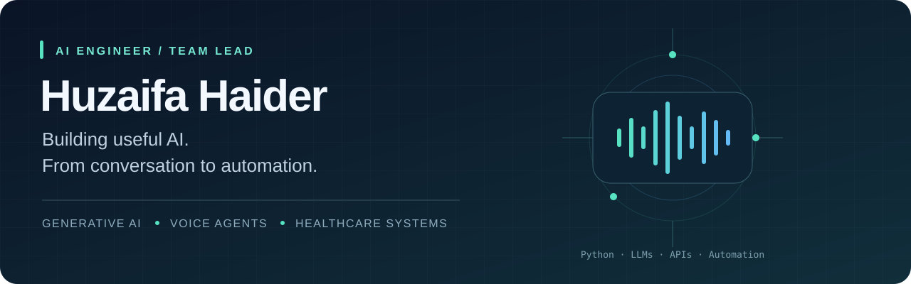

  

  
  
  

## Hi, I'm Huzaifa 👋

**AI Engineer & Team Lead at CareCloud**, building GenAI applications, LLM-powered voice agents, and healthcare automation.

I connect language models with real workflows: streaming conversations, tool execution, reliable APIs, and structured data. My work combines hands-on Python engineering with sprint planning, stakeholder communication, and production release support.

<table>
<tr>
<td width="33%" valign="top">
<h3>🎙️ Voice & agents</h3>
Real-time conversations, tool execution, and post-call workflows with LiveKit, MCP, and n8n.
</td>
<td width="33%" valign="top">
<h3>🧠 Applied GenAI</h3>
LLM applications, semantic search, embeddings, and model adaptation with LoRA/QLoRA and DPO.
</td>
<td width="33%" valign="top">
<h3>⚙️ Backend systems</h3>
Python APIs, asynchronous jobs, relational data, validation, and reliable integrations.
</td>
</tr>
</table>

## Selected work

**stratusAI · AI Voice Agent**  
Real-time streaming connections and tool execution, with n8n workflows for post-call logging and appointment management. Built exception handling and API retries into the backend.  
`Python` `LiveKit` `MCP` `n8n` `REST APIs`

**Custom LLM Fine-Tuning & Alignment Pipeline**  
Domain adaptation using LoRA/QLoRA, instruction tuning, label masking, and Direct Preference Optimization. Configured datasets, training pipelines, and generation parameters.  
`Unsloth` `LLaMA Factory` `Hugging Face`

**AI-Powered Smart Scheduling System**  
Booking, cancellation, and rescheduling APIs backed by relational models for doctor availability, conflict prevention, input validation, and error handling.  
`Python` `Django` `PostgreSQL` `REST APIs`

**Voice-Enabled Health Record System**  
Endpoints for querying and updating patient records through structured commands and embeddings, with database transactions and unit-tested updates.  
`Python` `LangChain` `Semantic Search` `SQL`

## Explore my public projects

| Project | What you'll find |
| :--- | :--- |
| [Product Description Generator](https://github.com/huzaifa-haider/product-description-generator) | Transformer-based text generation with PyTorch and Hugging Face tokenization. |
| [CNN Signature Recognition](https://github.com/huzaifa-haider/CNN_Signature_Recognition) | A notebook exploring signature recognition with a convolutional neural network. |
| [Word Completion with LSTM](https://github.com/huzaifa-haider/Word_Completion_using_LSTM) | A recurrent neural network project for next-word prediction. |
| [MentorMe](https://github.com/huzaifa-haider/mentorme-using-Firebase) | A Kotlin/Firebase mentorship app with booking, search, reviews, and chat. |

## Tools I work with

| Area | Technologies |
| :--- | :--- |
| **AI & GenAI** | LLM APIs · LangChain · Embeddings · Semantic search · LoRA/QLoRA · DPO |
| **Backend** | Python · FastAPI · Django · REST APIs · Asynchronous background jobs |
| **Data & frontend** | PostgreSQL · MySQL · SQL · Supabase · Firebase · JavaScript · Next.js |
| **Orchestration & tools** | LiveKit · MCP · n8n · Hugging Face · Unsloth · LLaMA Factory |
| **Engineering** | Git/GitHub · Postman · Linux · Automated testing · Debugging · Docker basics |

## Experience

**CareCloud · Team Lead** — September 2025–Present  
Lead sprint planning, task delegation, and milestone tracking; communicate technical decisions, diagnose bugs, and support stable production releases.

**CareCloud · Junior AI Engineer** — July–August 2025  
Developed Python backend services, REST integrations, asynchronous jobs, and automated data pipelines for healthcare workflows.

**CareCloud · AI Intern** — June 2025  
Wrote Python scripts to parse, evaluate, and test healthcare workflow inputs and outputs; collaborated through Git.

## Education & learning

**BS Computer Science · FAST-NUCES, Islamabad** — 2021–2025

DeepLearning.AI coursework:
- LangChain for LLM Application Development
- ChatGPT Prompt Engineering for Developers
- LangChain Chat with Your Data

---

  <b>Let's connect around useful AI, reliable systems, and thoughtful engineering.</b> 
  <a href="mailto:huzaifadev4@gmail.com">Email</a> &nbsp;·&nbsp;
  <a href="https://www.linkedin.com/in/huzaifa-haiderr/">LinkedIn</a> &nbsp;·&nbsp;
  <a href="https://huzaifa-haider.github.io/">Portfolio</a>

